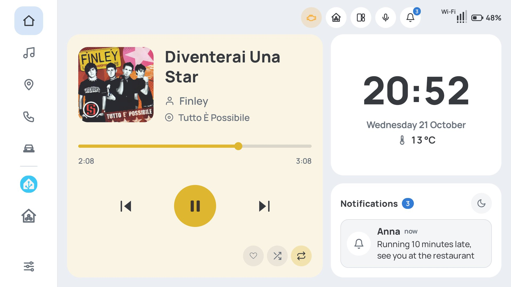
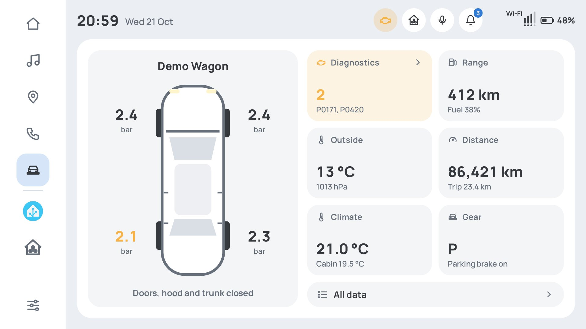
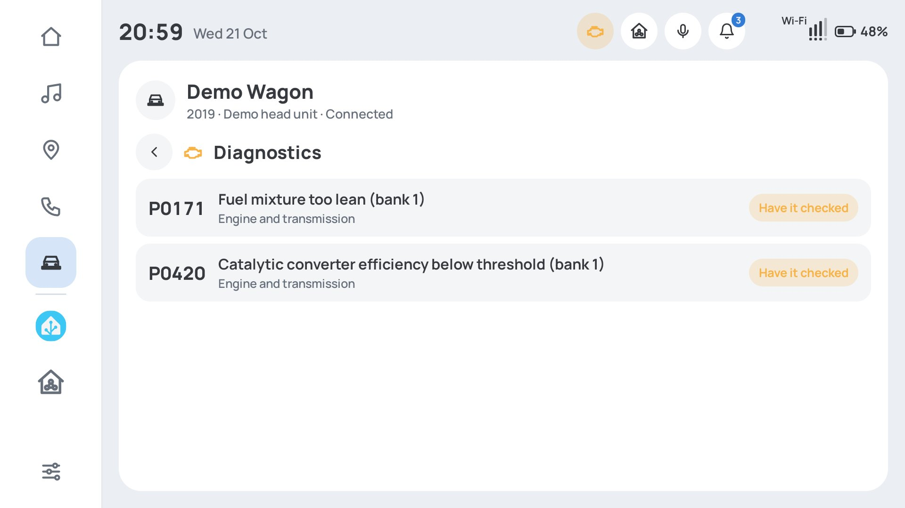
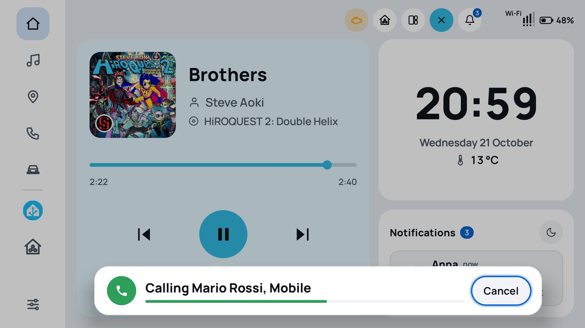
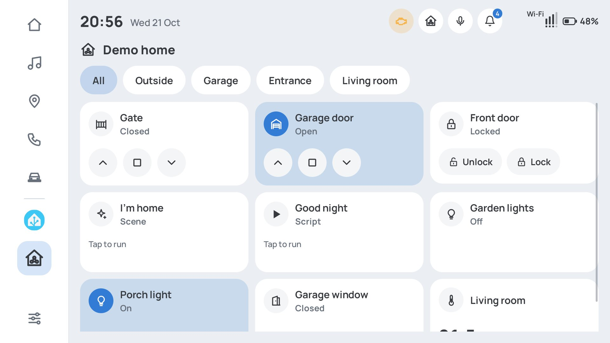
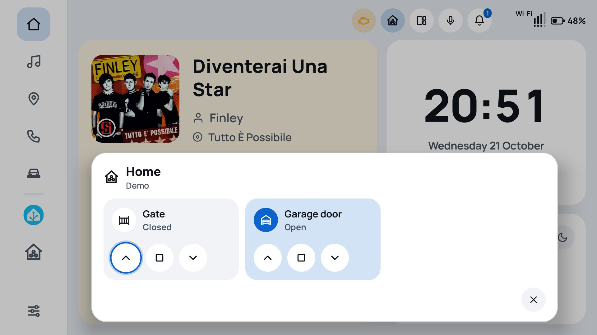
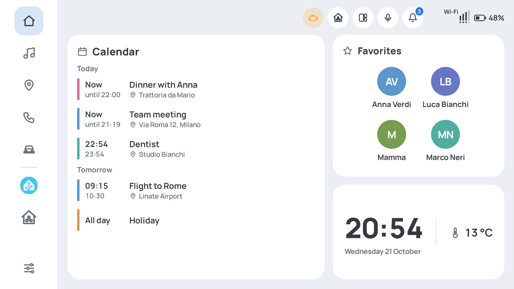
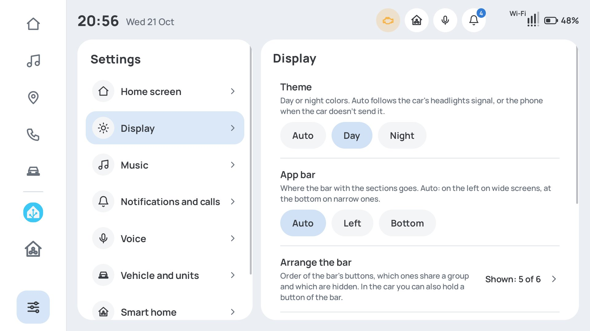
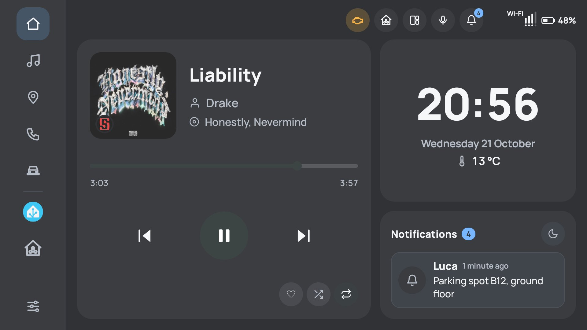

# BetterAuto

**A custom launcher for the car's Android Auto screen, with the Android Auto protocol written from
scratch.**

BetterAuto is an Android app that takes the place of Android Auto on the phone. When the phone is
plugged into a head unit, BetterAuto answers instead of Google's app, speaks the Android Auto
protocol itself and shows its own interface on the car screen: a widget-based home designed for the
road, with music, phone, notifications, vehicle data and voice commands.

It runs on head units that don't check the phone's certificate, such as the open-source Android Auto
receivers [Crankshaft](https://github.com/opencardev/crankshaft) and OpenAuto. Factory head units
built into cars want a certificate issued by Google: see [Where it works](#where-it-works). The
project is also a fairly complete map of what it takes to replace Android Auto on the phone side.

> ⚠️ Personal, experimental project, not affiliated with or endorsed by Google. Android Auto is a
> trademark of Google LLC.

## Screenshots

All taken from the car screen on the test bench. Messages, calls, calendar, car data and the smart
home are made up (the app has a demo mode for this).

| Home | Vehicle |
|---|---|
|  |  |
| **Fault codes, explained** | **Voice commands** |
|  |  |
| **Smart home** | **Arriving home** |
|  |  |
| **Widgets: calendar, favorites, clock** | **Settings** |
|  |  |
| **Call in progress** | **Night theme** |
|  |  |

More in [docs/screenshots](docs/screenshots): notifications, music library, keypad, portrait and
wide screens.

## Where it works

Android Auto opens every session with a TLS handshake inside the protocol. The head unit is the TLS
client and the phone is the server, so the phone presents a certificate, and what matters is whether
the head unit checks it.

- **Head units that don't verify the phone.** Open-source Android Auto receivers built on
  [aasdk](https://github.com/opencardev/aasdk), such as
  [Crankshaft](https://github.com/opencardev/crankshaft) and OpenAuto, skip the check
  (`SSL_VERIFY_NONE`), and so can other DIY receivers: BetterAuto works with them. Aftermarket radios
  with their own Android Auto receiver might too; none has been tried yet.
- **Factory head units**, the ones built into cars, accept phones whose certificate is issued by
  Google's Android Auto certificate authority. BetterAuto ships with a self-signed development
  certificate, so they refuse the connection, and the phone shows a notification explaining why.

How the phone's certificate is loaded is described in
[docs/DEVELOPMENT.md](docs/DEVELOPMENT.md#tls-certificate).

## What it does

Developed and tested with a Raspberry Pi 4 running Crankshaft as the head unit:

- 🔌 **The Android Auto protocol, from scratch in Kotlin**: USB accessory (AOA) negotiation,
  framing, TLS, service discovery, audio and video focus, and one class per service channel.
- 🖥️ **The car screen is a Jetpack Compose app**, drawn on a private virtual display, encoded as
  H.264 in hardware and streamed to the car; touch, rotary knob, joystick and steering wheel buttons
  come back the other way.
- 🎵 **Music player** for whatever plays on the phone (Spotify, YouTube Music, local FLAC
  players…), with cover art, colors taken from the album, library browsing and big controls.
- 🔊 **Car audio over the USB cable**, uncompressed PCM, captured from the phone and reduced to the
  car's format only at the very end, with dithering.
- 🚘 **Now playing, calls and phone signal on the car's own displays** (instrument cluster, driver
  info screen) when the car supports it.
- 📞 **Phone**: recents, favorites, contacts with A–Z jump, keypad, and a call screen to answer,
  hang up, mute and hold (call audio goes through the car's Bluetooth, as with Android Auto).
- 🔔 **Notifications** grouped by chat, with filters per app and for group chats, a quiet mode, and
  a privacy mode that hides what they say (on Auto, only while the car reports a passenger).
- 🚗 **Vehicle**: everything the car shares (tyre pressure, range, odometer, climate, gear, doors…),
  fault codes explained in plain words, and an engine-light shortcut in the top bar. On VW group cars
  the extra data of Exlap fills in what the standard Android Auto sensors leave out.
- 🏠 **Smart home** (Home Assistant first, other services can plug in): your gates, garage doors,
  locks, lights, scenes and scripts as big tiles with live state, one tap to act. Linking takes the
  address and Home Assistant's own sign-in; the devices you already share with your voice assistants
  come ticked. Arriving home (by the car's GPS, or the phone's during the drive) the gate and garage
  buttons slide in by themselves.
- 🎙️ **Voice commands** through the car's microphone, recognized offline by the phone itself:
  calls (with a cancel window before dialing), music, sections, quiet mode, reading messages.
- 🧩 **Widget home** with one, two or three widgets, an app bar and a top bar arranged from the
  settings. Widgets: music, notifications, favorite contacts (one tap calls), a big clock with the
  outside temperature, today's and tomorrow's events from the calendars you pick, and the weather, shown by hosting the
  phone's own weather app widget (no weather service of ours). Sensible defaults, nothing to set up
  unless a widget needs a permission, asked on the phone only when it is picked.
- 🌗 **Day and night themes** following the car's lights.
- 📐 **Any screen shape**, from 800×480 to wide dashboards and portrait displays.
- 🌍 English and Italian, following the phone's language.

Ideas for what could come next: maps with turn-by-turn directions, more smart-home services, a trip
log, wireless Android Auto.

## Trying it

You need an Android phone (Android 10 or newer), a head unit that doesn't verify the phone (see
[Where it works](#where-it-works); a Raspberry Pi with
[Crankshaft](https://github.com/opencardev/crankshaft) is the easy route) and a computer with
[ADB](https://developer.android.com/tools/releases/platform-tools).

1. **Build and install** with Android Studio, see [docs/DEVELOPMENT.md](docs/DEVELOPMENT.md). Open
   the app and follow its setup checklist.
2. **Disable the official Android Auto app**, otherwise it grabs the USB connection first. The
   `adb` commands to disable and re-enable it are in
   [docs/DEVELOPMENT.md](docs/DEVELOPMENT.md#disabling-android-auto).
3. **Optional: skip the audio prompt** on every connection:

   ```sh
   adb shell appops set com.simoneluconi.betterauto PROJECT_MEDIA allow
   ```

4. **Plug the phone into the head unit** and pick BetterAuto when Android asks which app to open.

## Car audio: how it works

The official Android Auto is a system app, with permissions that let it *move* all of the phone's
sound to the car. BetterAuto is a regular app, so by default it *copies* other apps' sound instead,
through the screen-capture permission. It works well, with a few side effects:

- Android shows a permission prompt on every connection (an `adb` command removes it) and a
  screen-sharing indicator while audio goes to the car;
- the phone's own speaker is muted while connected, since the sound is copied, not moved;
- apps can refuse to be captured (typically paid video apps), and navigation prompts from other
  apps can't be captured;
- calls go over Bluetooth, which is what Android Auto does too.

Sound quality is great: Android Auto carries uncompressed PCM (typically 48 kHz / 16-bit), better
than Bluetooth.

### With Shizuku: the sound is moved, like the official app

If [Shizuku](https://play.google.com/store/apps/details?id=moe.shizuku.privileged.api) is installed,
running and BetterAuto is allowed to use it, BetterAuto moves media audio to the car the way the system
app does (an audio policy registered through Shizuku): no permission prompt, no screen-sharing
indicator, the phone speaker is not muted by BetterAuto (the sound simply isn't there any more), and
apps that only block capture by regular apps play too. The app's setup checklist shows whether Shizuku
is installed, running and allowed. Without Shizuku, or if it stops, BetterAuto copies the sound as
described above, automatically.

- **With the USB cable, Shizuku needs a rooted phone.** Started without root (wireless debugging),
  Shizuku stops as soon as the phone connects to the car: switching the USB port to accessory mode
  restarts Android's debugging service, which Shizuku runs under. BetterAuto then falls back to
  copying. Wireless Android Auto (planned) won't have this limit.
- Without root, Shizuku must be started again after every phone restart. Keep *Developer options*
  and *USB debugging* on, enable *Disable adb authorization timeout* (Android 11+) and let Shizuku run
  in the background (see the [Shizuku guide](https://shizuku.rikka.app/guide/setup/)).

## Status

Tested on a Samsung Galaxy S25 Ultra (Android 17) with a Raspberry Pi 4 running Crankshaft.

## How it works, in short

When the phone is plugged in, the head unit asks it to start Android Auto. BetterAuto answers
instead, speaks the protocol, draws its interface on a virtual screen, encodes it as video and
streams it to the head unit, along with the audio. Touches, knob turns, button presses, sensor data
and the microphone travel back the other way. Architecture, build, test bench and debugging tools
are in [docs/DEVELOPMENT.md](docs/DEVELOPMENT.md).

## License and credits

The Android Auto protocol definitions come from
[opencardev/aasdk](https://github.com/opencardev/aasdk), licensed under GPLv3, so BetterAuto is
distributed under the GPLv3 as well: see [LICENSE](LICENSE).
